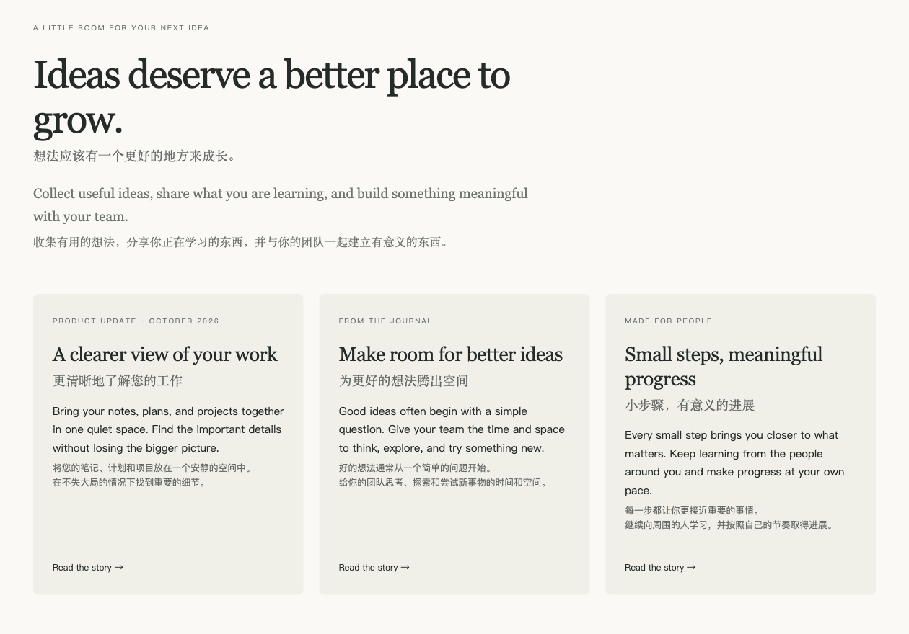
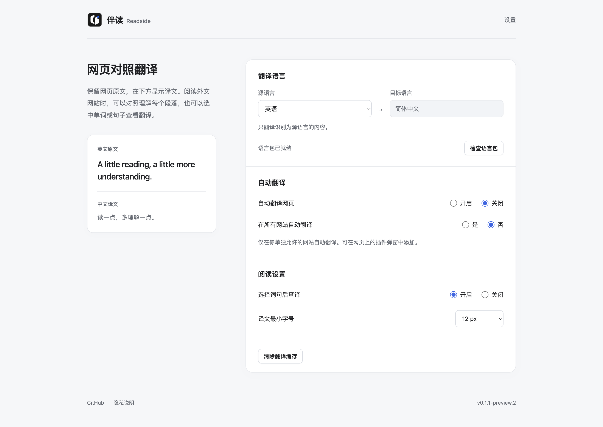

<p align="center">
  
</p>
<h1 align="center">Readside</h1>
<p align="center">保留原文，让译文陪你读懂每一页。</p>
<p align="center">
  <a href="https://github.com/wuyi4514/readside/releases/latest">下载</a> ·
  <a href="docs/INSTALL.md">安装指南</a> ·
  <a href="docs/USAGE.md">使用指南</a> ·
  <a href="PRIVACY.md">隐私说明</a> ·
  <a href="CONTRIBUTING.md">参与贡献</a>
</p>
<p align="center">
  <a href="https://github.com/wuyi4514/readside/releases/latest"></a>
  <a href="LICENSE"></a>
  
</p>

Readside 是一个开源的网页对照翻译插件。在标题和段落下方显示译文，保留网页原有的内容、链接和交互，帮助你阅读外文网站，也在阅读中学习语言。



## 功能

- **对照阅读**：原文与译文逐块对应，译文使用更轻的字级和颜色。
- **多语言**：源语言可多选，目标语言单选，支持英语、法语、西班牙语、德语、日语、韩语和简体中文。
- **自动翻译**：为所有已授权网站开启，或只在单独允许的网站使用。
- **当前页操作**：随时翻译当前页、恢复原文，不必修改全局偏好。
- **词句查译**：选择文字后查看翻译，支持复制原文和译文。
- **阅读设置**：支持明暗主题、译文最小字号和动态加载内容。
- **翻译服务**：默认使用 Chrome 本地翻译，也可选择 Google 或 Microsoft 在线翻译，无需填写 API Key。
- **全页扫描**：覆盖正文、导航、侧栏、按钮、列表和表格中的可见文字，持续识别动态内容。

Readside 依据通用内容语义和布局识别阅读区域，不依赖特定网站的域名、私有 class 或帖子标记。正文译文在下方显示，紧凑控件使用随文排列；空间不足时优先保留网站布局。

## 安装

1. 前往 [Releases](https://github.com/wuyi4514/readside/releases/latest)，下载 `readside-0.3.1.zip` 并解压。
2. 在桌面 Chrome 打开 `chrome://extensions`，开启“开发者模式”。
3. 点击“加载已解压的扩展程序”，选择直接包含 `manifest.json` 的目录。
4. 固定 Readside，打开设置，选择语言并准备对应翻译方向。

开启自动翻译并授予网站访问权限后，打开网页即可开始对照阅读。详细步骤见[安装指南](docs/INSTALL.md)。

## 使用

默认将英语翻译为简体中文。你可以选择多种源语言，并将它们统一翻译成一个目标语言；未选择的语言保持原样。

本地翻译能力按“源语言 → 目标语言”准备，已有模型由浏览器复用，缺少时按需下载。实际下载时显示圆环进度，支持取消与重试；源与目标相同时无需翻译。可用方向由当前 Chrome 的本地翻译能力决定。

<details>
<summary>查看设置界面</summary>



</details>

更多操作和常见问题见[使用指南](docs/USAGE.md)。

## 隐私

默认本地模式在设备上处理文字。选择 Google 或 Microsoft 后，待翻译的纯文本片段发送至相应服务，不附带网页 URL、Cookie 或账号资料；在线服务无需下载语言包。切换前会请求该服务的访问权限，不会自动从本地模式切换到在线服务。

Readside 没有项目服务器、账号、广告或遥测。本地模型由 Chrome 下载和管理。在线翻译使用服务商的公开网页端点，其可用性受网络、限流和接口变化影响；并非 Google Cloud 或 Azure 的付费 API 服务。

开关、语言、字号和网站规则保存在本机；正文和译文使用有限内存缓存。详见[隐私说明](PRIVACY.md)。

## 兼容性

需要桌面 Chrome 138 或更高版本。本地模式需要浏览器支持内置 Translator 和 Language Detector；在线模式需要连接所选服务。设备条件、浏览器策略、存储空间和语言方向会影响本地模型可用性。

主要面向普通 HTTPS 网页。浏览器内部页面、扩展商店、内置 PDF、图片、视频、跨域 iframe 和封闭 Shadow DOM 不属于自动翻译范围。

## 从源码构建

需要 Node.js 24 和 npm。

```sh
git clone https://github.com/wuyi4514/readside.git
cd readside
npm ci
npm run build
```

构建输出在 `dist/`，可直接加载到 Chrome。执行 `npm run package` 可生成分发 ZIP。

## 文档与贡献

- [安装指南](docs/INSTALL.md)：安装、更新与语言包准备。
- [使用指南](docs/USAGE.md)：日常操作、语言设置和常见问题。
- [产品规格](SPEC.md)：功能行为、设置规则与阅读体验。
- [技术架构](docs/TECHNICAL_SPEC.md)：模块职责、消息、生命周期与本地引擎。
- [更新记录](docs/CHANGELOG.md)：各版本的功能与改进。
- [贡献指南](CONTRIBUTING.md)：本地开发、代码约定与提交方式。

欢迎通过 [Issues](https://github.com/wuyi4514/readside/issues) 提交建议和兼容性问题。分享页面样例前，请去除个人信息与登录凭据。

## License

[MIT](LICENSE) © 2026 wuyi4514.
